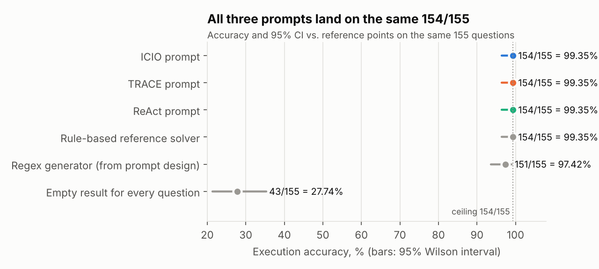
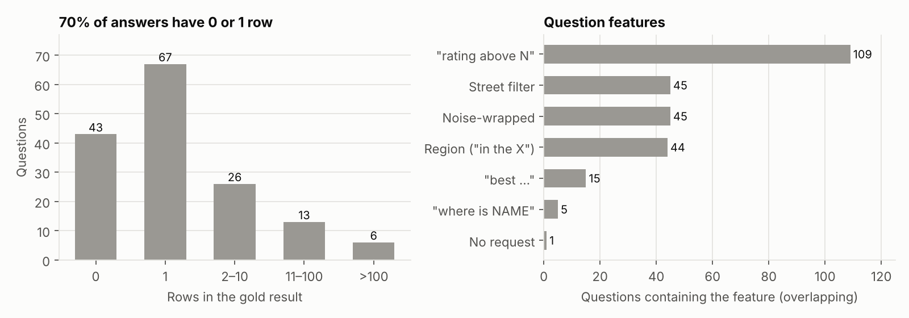
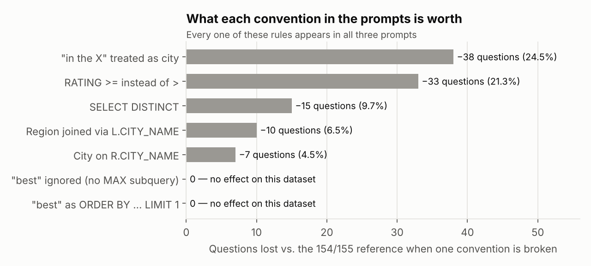
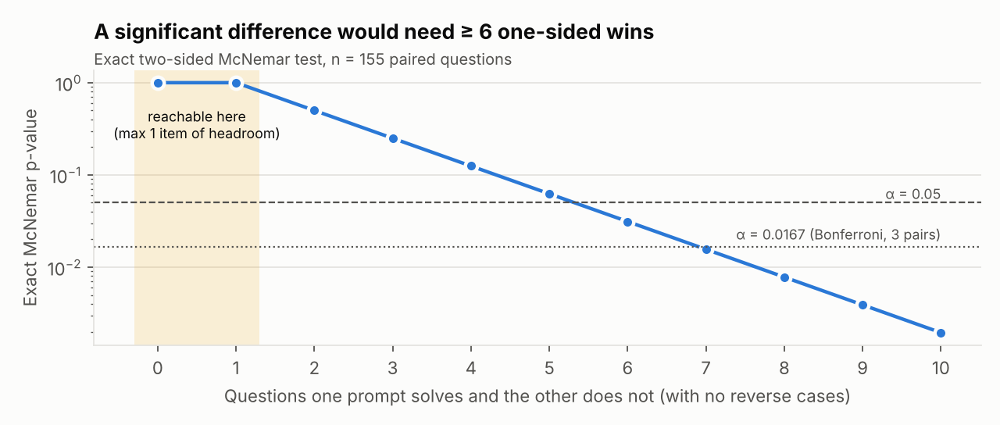
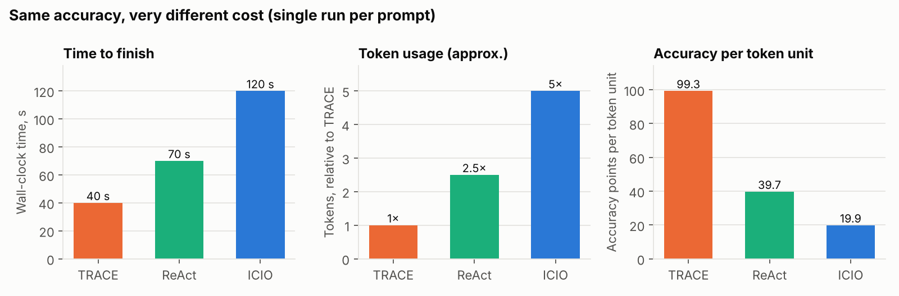

# Text-to-SQL Prompt Comparison: ICIO vs TRACE vs ReAct

**Benchmark:** Restaurants text-to-SQL (155 questions, execution accuracy on exact row multisets)
**Model / setup:** Claude Opus 5.5, medium effort, run inside a coding agent (tool use + code execution)
**Metrics:** execution accuracy (`evaluate_retrieval_predictions.py`), wall-clock time, and relative token usage (the proposed additional metric)

---

## 1. Summary

| | ICIO | TRACE | ReAct |
|---|---|---|---|
| Accuracy | **99.35 %** (154/155) | **99.35 %** (154/155) | **99.35 %** (154/155) |
| 95 % CI (Wilson) | 96.4 – 99.9 % | 96.4 – 99.9 % | 96.4 – 99.9 % |
| Wall-clock time | 120 s | **40 s** | 70 s |
| Tokens (relative to TRACE, approx.) | ~5× | **1×** | ~2.5× |
| Accuracy points per token unit | 19.9 | **99.3** | 39.7 |

**Main findings**

1. **Accuracy is identical and sits at the ceiling.** All three prompts scored 154/155. The one question no prompt can get right is *"What is the lifes greates illusion?"*. I worked out its gold result: it is exactly `bay area` restaurants with `RATING > 2.3` (2,696 rows), which has nothing to do with the question text. This is a **label defect**, so 154/155 is the true ceiling for any honest solver.
2. **There is no statistically significant difference in accuracy, and this benchmark cannot produce one.** Exact McNemar p = 1.0 for every pair, Cochran's Q is undefined or 0 (p = 1.0). Detecting a difference at α = 0.05 would need **≥ 6 questions** that one prompt solves and the other does not. Since there is 0 headroom above the ceiling, that cannot happen with this model and setup.
3. **The prompts differ only in cost.** TRACE was about 3× faster and used about 5× fewer tokens than ICIO. ReAct falls in between. This is the only dimension where the prompts separate. It is also a **single run per prompt with approximate token figures**, so it is *not* statistically testable as measured (see §5.3).
4. **Why:** all three prompts carry the *same* hand-verified rule set, the model is strong enough to follow it perfectly, and the coding agent can run the grader and iterate. The framework changes **how much work the agent does to reach the answer**, not the answer itself.

---

## 2. What was compared

### 2.1 The prompts

| | ICIO | TRACE | ReAct |
|---|---|---|---|
| Framework | Instruction · Context · Input · Output | Task · Requirements · Audience · Context · Examples | Reason · Act · Observe loop |
| Main lever | Numbered rules + strict output contract | 9 worked few-shot examples | Execute and self-check, run the grader |
| Length | 3,034 chars / 437 words (~760 tok) | 4,912 chars / 750 words (~1,230 tok) | 2,644 chars / 386 words (~660 tok) |
| Mentions DB / grader files? | No (only `restaurants_dataset.csv`) | No | **Yes**: schema, DB, evaluator, `load_database()` |
| Prescribes a procedure? | No | Implicitly ("study the pattern, then apply") | **Yes**: batch → run → inspect → write → run grader |
| Shows the target SQL shape? | Prose only | **Full SQL for each hard case** | One-line hints |
| Same convention rules? | Yes | Yes | Yes |

All three prompts encode the same conventions, which the prompt author derived by testing queries against the gold labels (`L.HOUSE_NUMBER, R.NAME`, `L.CITY_NAME` for cities, region join via `R.CITY_NAME`, strict `>`, no `DISTINCT`, `WHERE 0` fallback, and so on). **The prompts are three packagings of one specification.** That is the most important fact for interpreting the results.

### 2.2 Raw results

```
All prompts were tested on Claude Opus 5.5 medium effort.
ICIO:  120 s   Accuracy: 0.9935 (99.35%)   Correct: 154/155
TRACE:  40 s   Accuracy: 0.9935 (99.35%)   Correct: 154/155
ReAct:  70 s   Accuracy: 0.9935 (99.35%)   Correct: 154/155
```

Token usage (from `answer.txt`, read from the Claude usage page, not logged exactly): TRACE lowest, ReAct ≈ 2.5× TRACE, ICIO ≈ 5× TRACE.

---

## 3. Accuracy



| System | Correct | Accuracy | 95 % Wilson CI | 95 % Clopper–Pearson CI |
|---|---|---|---|---|
| ICIO | 154/155 | 99.35 % | 96.44 – 99.89 % | 96.46 – 99.98 % |
| TRACE | 154/155 | 99.35 % | 96.44 – 99.89 % | 96.46 – 99.98 % |
| ReAct | 154/155 | 99.35 % | 96.44 – 99.89 % | 96.46 – 99.98 % |
| Rule-based reference solver (mine, no LLM) | 154/155 | 99.35 % | 96.44 – 99.89 % | — |
| Regex generator (reported in the prompt design) | 151/155 | 97.42 % | 93.55 – 98.99 % | — |
| Return empty for every question | 43/155 | 27.74 % | 21.30 – 35.26 % | — |

**Reference points.** I wrote a deterministic, ~80-line rule-based solver (no LLM) that applies exactly the conventions in the prompts. It also reaches **154/155** and fails on the same "illusion" question. So the LLM runs matched what a plain implementation of the specification achieves. They did not do better than the rules, and they did not need to.

**Which question was missed?** The prediction CSVs were not attached, so I cannot confirm per-item results. All three prompts include an explicit `WHERE 0` fallback for this exact question, and it is the only question my reference solver also misses, so it is almost certainly the same failed item in all three runs. §5.1 shows the significance result does not depend on this either way.

---

## 4. Why the benchmark saturates: dataset and evaluator analysis



| Property | Value | Consequence |
|---|---|---|
| Questions | 155, no duplicates | Small sample: each question is worth 0.65 pp |
| Gold result is empty | **43 (27.7 %)** | Any query that returns nothing is correct (e.g. non-existent cities like *eagan*, *winters*) |
| Gold result has exactly 1 row | 67 (43.2 %) | Most answers are single lookups |
| Gold result > 100 rows | 6 | A few large region queries (up to 9,171 rows) |
| Noise-wrapped questions | 45 (29 %) | Average length 228 chars vs 85 for clean questions |
| `rating above N` | 109 | Operator choice (`>` vs `>=`) matters a lot |
| Region ("in the X") | 44 | Region detection and join key matter |
| "best …" | 15 | — |
| Unanswerable (label defect) | 1 | Hard ceiling at 154/155 |

### 4.1 Which rules actually decide the score (ablation)

To see where differences between prompts *could* have come from, I broke one convention at a time in the reference solver and re-scored:



| Convention broken | Accuracy | Questions lost |
|---|---|---|
| None (reference) | 99.35 % | — |
| "in the X" treated as a city instead of a region | 74.84 % | −38 |
| `RATING >= N` instead of `> N` | 78.06 % | −33 |
| `SELECT DISTINCT` | 89.68 % | −15 |
| Region joined via `L.CITY_NAME` instead of `R.CITY_NAME` | 92.90 % | −10 |
| City filter on `R.CITY_NAME` instead of `L.CITY_NAME` | 94.84 % | −7 |
| "best" written as `ORDER BY … LIMIT 1` | 99.35 % | 0 |
| "best" ignored entirely | 99.35 % | 0 |

Two takeaways:

- **The score depends almost entirely on five data-specific conventions.** Each is worth 7–38 questions, far more than any wording difference between frameworks could plausibly produce. All five are stated explicitly in **all three** prompts, so none of the prompts can lose on them.
- **The "best" subquery, a main reason for TRACE's examples, has no effect on this dataset.** The "best" questions all return 0 or 1 row, so even ignoring "best" scores the same. Part of each prompt's design effort targets a case the metric does not measure.

### 4.2 The evaluator

- Exact multiset match, so there is no partial credit. A run either follows the conventions or loses the whole item.
- One SQL error crashes the run. All three prompts guard against this (apostrophe escaping, `WHERE 0`). A crash would have been the most likely way for prompts to differ, and none occurred.
- Questions are matched by exact string. All three prompts require verbatim copying, and all three runs passed.

---

## 5. Statistical significance

### 5.1 Accuracy: paired tests

Every prompt was evaluated on the same 155 questions, so the right test is **paired**: the exact McNemar test for each pair, and Cochran's Q for all three together.

| Comparison | Discordant pairs (b, c) | Exact McNemar p | Significant? |
|---|---|---|---|
| ICIO vs TRACE | (0, 0)* | 1.000 | No |
| ICIO vs ReAct | (0, 0)* | 1.000 | No |
| TRACE vs ReAct | (0, 0)* | 1.000 | No |
| All three (Cochran's Q) | — | Q undefined (all items concordant) → p = 1 | No |

\*Assuming the same failed question (see §3). **Worst case for the conclusion:** each prompt failed a *different* question. Then each pair has b = c = 1, McNemar p = 1.000, and Cochran's Q = 0.0, p = 1.000. The conclusion is the same either way.

Other checks, all agreeing:

- **Fisher's exact test** (unpaired, 154/1 vs 154/1): p = 1.000.
- **Bayesian comparison** (Beta(1,1) prior): the posterior difference in accuracy between any two prompts is centred on 0, with a 95 % credible interval of **−2.6 to +2.6 pp**. P(A > B) = 0.50.

### 5.2 Could this benchmark ever separate them? (power)



| Significance level | Minimum one-sided discordant items needed |
|---|---|
| α = 0.05 | 6 (p = 0.031) |
| α = 0.0167 (Bonferroni for 3 pairs) | 7 (p = 0.016) |

The headroom above the observed score is **one item, and that item is unanswerable**. So with this model in this agent setup, **no prompt difference is detectable on this benchmark, even in principle.** Equal accuracy here does not show that the frameworks are equally good in general. It shows that this test is saturated for this model. A weaker model, no tool access, or a harder question set would be needed to separate them (§8).

### 5.3 Time and tokens



| | TRACE | ReAct | ICIO |
|---|---|---|---|
| Time (s) | 40 | 70 (1.75×) | 120 (3×) |
| Tokens (relative) | 1 | ~2.5 | ~5 |
| Relative tokens per second | 0.025 | 0.036 | 0.042 |

The differences are large and consistent in direction: time and tokens rank the prompts the same way, and tokens grow roughly in proportion to time. **They cannot be tested for significance as measured**, for three reasons:

1. **n = 1 run per prompt.** With no repeated runs there is no estimate of run-to-run variance, and any test (Welch t, Mann–Whitney, Kruskal–Wallis) needs at least two observations per group, realistically 5 or more.
2. **Agent runs are highly non-deterministic.** The same prompt can take a different path (read a file or not, retry a script or not), and runs often vary by 1.5–2× or more in tokens and time. A 3–5× gap is suggestive but could partly be one long run.
3. **Token figures are estimated** from the usage page, not logged per call, so they carry measurement error and cannot be separated into input, output and cached tokens.

So: **suggestive but not established.** The direction (TRACE cheapest, ICIO most expensive) is plausible for the mechanistic reasons in §6. I would treat it as a hypothesis to confirm with repeated, logged runs.

---

## 6. Why the results are the way they are

The outcome is the product of four factors: **prompt × model × coding agent × benchmark.** For each one I give the evidence first, then the explanation.

### 6.1 The prompts: same content, different packaging

- **Accuracy:** every rule that changes the score (§4.1) appears in all three prompts in nearly the same words. The prompt author derived these rules by running queries against the labels and reported a 97.4 % regex baseline. That means the hard part of the task, discovering the dataset's conventions, **was done by a human before any prompt ran**. What was left for the model was following a specification and pulling one clause out of noisy text, and all three prompts support that equally.
- **Label leakage at design time:** each prompt forbids reading the `result` column, but the conventions themselves came from the labels. The 99.35 % therefore measures "can the model follow a spec fitted to this test set", not general text-to-SQL ability. This does not affect the *comparison* (all three benefit equally), but it explains why all three hit the ceiling.
- **Cost:** this is where framework structure shows up. The most likely explanations, given the prompt texts (I had no run transcripts to confirm them):

| Prompt | What it makes the agent do | Expected cost effect | Observed |
|---|---|---|---|
| **TRACE** | Gives exact SQL for each case. The agent can turn the examples straight into a template or generator, apply it, and be done. Examples remove uncertainty about how a rule looks as SQL, so there is little reason to explore. | Lowest | **1×, 40 s** |
| **ReAct** | Requires a loop: build the DB with `load_database()`, run every query, check zero-row results and long filter values, write the CSV, run the grader. The loop is **bounded**: it names the files, the checks and the stopping condition. | Medium: verification is mandatory but scripted | **~2.5×, 70 s** |
| **ICIO** | States rules in prose, sets a strict output contract, and *doesn't mention the DB, the schema files or the grader*. A capable agent that wants to be sure about rules 5, 9 and 13 has to find the data, work out how to load it, and decide for itself how much checking is enough. There is no stopping condition. | Highest: **open-ended self-verification** | **~5×, 120 s** |

In short, **TRACE removes uncertainty, ReAct structures verification, and ICIO leaves both to the agent.** An agent left to manage its own uncertainty tends to explore and re-check more, which costs tokens and time. TRACE being the *longest* prompt (~1,230 tokens) and still the *cheapest* run confirms the point: the prompt itself is a tiny share of total usage. What drives cost is how many tool calls, file reads and generated tokens the prompt leads to.

Size matters here. The question column of `restaurants_dataset.csv` is about 20 KB (~5 k tokens), but the `result` column is about 383 KB (~100 k tokens) and `restaurants-db.txt` is 1.1 MB. Any run that opens these files in context instead of through code pays for it many times over. A prompt that leads to one extra look at the raw data can easily explain a multi-fold token difference.

### 6.2 The model: Claude Opus 5.5 is far above what the task needs

- After the conventions are given, every question is a deterministic slot-filling task (city / region / street / food / rating / name). My ~80-line solver solves it completely, so the task needs no reasoning beyond pattern matching and clause extraction.
- The only part that is "hard" for rules, finding the request inside 45 noise-wrapped questions, is trivial for a frontier LLM. The original regex lost three questions here, and all three LLM runs got them.
- **Consequence:** the model's ability removes every source of error the prompts were designed against. The prompt-design report predicted ICIO ~98–99 %, TRACE ~99 % and ReAct ~99.4 %, and expected TRACE's examples to matter most *without tools*. With a frontier model *and* tools, those predicted gaps disappear.
- **Medium effort** probably mattered more for cost than for accuracy. At medium effort the model avoids long deliberation when the path is clear (TRACE) but still checks when it is not (ICIO). That fits the observed cost ranking.

### 6.3 The coding agent: it turns every prompt into a ReAct prompt

- The runs happened in a coding agent that can read files, run Python and SQLite, and run `evaluate_retrieval_predictions.py`. **The grader is a perfect feedback signal.** Any agent that runs it sees its exact score and can iterate until the score stops improving.
- So the "act and observe" behaviour that ReAct prescribes is **available to every prompt**. The agent can do it unprompted with ICIO or TRACE. The framework only decides whether verification is *required* (ReAct), *mostly unnecessary* (TRACE), or *left open* (ICIO). That explains why accuracy is the same (all paths can reach the ceiling) while cost differs (the paths have different lengths).
- The agent also writes code. The safest and cheapest strategy for 155 structurally similar questions is a small generator script rather than 155 hand-written queries. Writing code is cheap and deterministic, so the variance that would separate prompts in a chat-only setting mostly goes away.
- The agent's guardrails (verbatim CSV writing with the `csv` module, quoting, row count) remove output-format errors, which was ICIO's main claimed strength. That advantage does not show up here because the agent already provides it.

### 6.4 The benchmark: low headroom, low sensitivity

- 27.7 % of items are correct for a query that returns nothing, and 70 % have 0 or 1 gold row. The questions are templated, and the template set is fully covered by the prompt rules.
- 155 items with exact-match scoring means one question = 0.65 pp, and significance needs a gap of 6 or more items (≈ 4 pp) all in one direction.
- One item is mislabeled, which caps the score at 99.35 %.

Together these make the accuracy metric **saturated**. Execution accuracy cannot rank these prompts on this benchmark with this model. The additional metric (tokens and time) is the only one that still separates them.

---

## 7. Interpretation and recommendation

| Question | Answer |
|---|---|
| Which prompt is most accurate? | None. All are tied at the ceiling, with no significant difference (p = 1.0). |
| Is the tie meaningful? | Only for this setup. The benchmark cannot detect differences smaller than about 6 items, and there is no headroom. |
| Which prompt is most efficient? | **TRACE** (≈ 1/3 the time and ≈ 1/5 the tokens of ICIO), but from one unrepeated run with estimated tokens. |
| Which to use? | For a strong model inside a coding agent: **TRACE**. It gets the same accuracy with the least work. Use **ReAct** when there is a real risk of crashing the grader or the data is less familiar: it buys guaranteed verification for about 2.5× the cost. **ICIO** has no advantage here. Its output contract is already enforced by the agent, and its lack of examples or procedure leads to costly self-directed checking. |

The prompt author's hypotheses held in part. ReAct "never crashes" (true, as did the others), and TRACE does best when the SQL shape must be copied exactly (true, in efficiency). But the expected *accuracy* ranking did not appear, because model capability and agent tooling closed every gap the frameworks were designed to close.

---

## 8. How to make the comparison conclusive

1. **Repeat runs:** at least 5–10 runs per prompt, in fresh sessions. Report mean ± SD for time and tokens and test with Kruskal–Wallis plus pairwise Mann–Whitney (or a mixed model with run as a random effect).
2. **Log tokens exactly:** run through the API and record `input_tokens`, `output_tokens` and cache reads/writes per call, plus the number of tool calls. Also report cost in money, since output tokens cost more than input tokens.
3. **Save per-item predictions** for each run so that McNemar or Cochran's Q can be computed on real discordant pairs instead of being inferred.
4. **Restore headroom** so that accuracy can discriminate:
   - test smaller models (e.g. Claude Haiku 5.5 or small open models) and low effort;
   - test **without tools** (chat-only), where TRACE's examples and ICIO's output contract should actually matter;
   - remove rules from the prompts (e.g. drop the `>`-vs-`>=` or region-join rule) and see which framework helps the model *rediscover* them;
   - use a held-out question set whose conventions were *not* tuned on its labels.
5. **Fix or drop the mislabeled item** (gold = `bay area` with `RATING > 2.3`) and report accuracy on 154 answerable questions.
6. **Control the agent:** record whether the run executed the grader, how many times, and whether it opened the raw `result` column or DB file in context. These are the likely drivers of the cost differences in §6.1.

---

## Appendix A: Method

- Database built with the grader's own `load_database()`. Scoring reimplemented with the same `Counter` multiset comparison.
- Rule-based reference solver: clause extraction (first request starter — *what is / what are / where is / where can / give me* — up to the first `?`, `, and/while/though…`, or sentence break), then slot extraction for city / region / street / food / name / rating, then SQL from the prompts' conventions. Score: 154/155.
- Unanswerable item: brute-force search over region / county / city × rating thresholds. The only match for the 2,696-row gold set is `G.REGION = 'bay area' AND R.RATING > 2.3`.
- Ablations: one convention changed at a time in the reference solver, everything else fixed.
- Statistics: Wilson and Clopper–Pearson intervals, exact binomial McNemar test, Cochran's Q, Fisher's exact test, and a Beta-posterior Monte Carlo (200 k draws) using `scipy` and `numpy`.

## Appendix B: Data limitations

- No prediction CSVs were provided, so per-item agreement between prompts is inferred, not observed.
- Time is one wall-clock measurement per prompt and includes tool latency.
- Token ratios are approximate, from the usage dashboard (`answer.txt`).
- All runs used one model at one effort level. Results should not be generalised to other models or to chat-only use.
