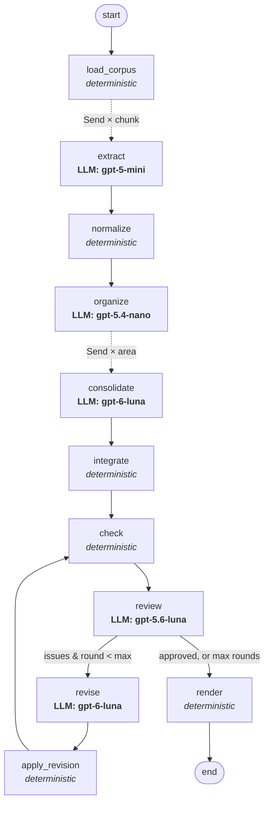

# ReqNet — Agentic Network for Requirements Refinement

*AI4SE Lab, Week 4, Task 1 — design report*

## 1. Overview

ReqNet turns a directory of heterogeneous texts about a software system (email threads,
meeting minutes, interviews, surveys, draft specifications, reference notes) into a single
structured requirements specification. It is implemented as a LangGraph `StateGraph` with
**11 nodes: 5 agentic (LLM) nodes and 6 deterministic nodes**, two map-reduce fan-outs and a
review → revise **feedback loop**. All LLM calls go to the OpenAI API, using **four different
models**, each chosen for the difficulty of its role.

```
python run.py --input <corpus_dir> --output <out_dir>
```

The only input is a directory path; files are discovered recursively, so the network works on
any similar corpus (a second, unrelated toy corpus was used to check this).

## 2. Architecture



### 2.1 Nodes

| # | Node | Kind | Model | Responsibility |
|---|------|------|-------|----------------|
| 1 | `load_corpus` | deterministic | – | Recursively reads text files (`.txt`, `.eml`, `.md`, …), assigns `DOC-NN` ids, infers document type (email thread, minutes, interview, survey, draft spec, …) and date (e-mail `Date:` header, ISO date in the filename, or a date in the header), and splits long documents into paragraph-aligned chunks (≤ 9 000 chars, 1-paragraph overlap). |
| 2 | `extract` | **agentic**, parallel (one `Send` per chunk) | gpt-5-mini | Extracts every candidate requirement from one chunk: title, normalized "The system shall…" statement, type, short verbatim quote, stakeholder, priority signals, status (proposed/agreed/rejected/questioned) and a *suspicious* flag for nonsensical or off-topic requests. |
| 3 | `normalize` | deterministic | – | Gives each candidate a stable id `C-NNN`; folds verbatim/near-verbatim duplicates (token Jaccard ≥ 0.9, typically produced by chunk overlap) while keeping the duplicate's document in `also_in`, so tracing is not lost. |
| 4 | `organize` | **agentic** | gpt-5.4-nano | Proposes a taxonomy of functional areas (count scales with backlog size) and assigns each candidate to one area, in batches. A deterministic fallback assigns anything the small model skipped or mis-coded by lexical overlap with the area description. |
| 5 | `consolidate` | **agentic**, parallel (one `Send` per area, large areas split) | gpt-6-luna | The core analyst: merges semantic duplicates, resolves conflicts by authority and date, writes each requirement (name + paragraph), assigns priority with a rationale, and moves conflicting / nonsensical / rejected candidates to the discard list with a reason. Every input candidate must end up in exactly one place. |
| 6 | `integrate` | deterministic | – | Merges the per-area results, assigns working ids `REQ-<AREA>-NNN` / `DIS-NNN`. |
| 7 | `check` | deterministic | – | Quality gate that computes hard facts: uncovered candidates (completeness), requirements without sources (traceability), lexically near-duplicate pairs across *all* areas, too-short descriptions / too-long names, and use of glossary-forbidden synonyms. |
| 8 | `review` | **agentic** | gpt-5.6-luna | Independent critic (a different model from the author). Receives the whole spec, the discard list, the document metadata and the automatic findings; returns `approved`, a list of typed issues (duplicate, conflict, terminology, coverage, quality, priority, blacklist, traceability; blocking/minor) and a glossary of preferred terms. |
| 9 | `revise` | **agentic** | gpt-6-luna | Fixes the issues by emitting typed edit operations — `update`, `merge`, `discard`, `add`, `attach`, `restore` — instead of rewriting the whole document. It sees only the affected requirements, the uncovered candidates and the glossary. |
| 10 | `apply_revision` | deterministic | – | Validates and applies the operations (unknown ids are rejected and logged, merges keep the union of sources, discards move to the blacklist). Loops back to `check`. |
| 11 | `render` | deterministic | – | Final gap-free ids ordered by priority, Markdown + JSON specification, traceability matrix, QA record, run log with token usage. |

### 2.2 Feedback loops

1. **Graph-level review loop (ANS3).** `check → review → revise → apply_revision → check …`.
   The router (`route_after_review`) ends the loop only if the reviewer approves, no blocking
   issue remains *and* the deterministic check finds no uncovered candidate — or when
   `--max-review-rounds` (default 3) is reached. Pairing a deterministic checker with an LLM
   reviewer means objective problems (a candidate lost on the way, a requirement with no
   source) cannot be "approved away" by the reviewer.
2. **Call-level self-correction.** Every LLM answer is validated against a pydantic schema; on
   failure the validation error is sent back to the same model, which must return a corrected
   object (up to 3 attempts).

### 2.3 Model selection (ANS4)

| Role | Model | Why |
|------|-------|-----|
| Extraction (~25 parallel calls) | `gpt-5-mini` | Most calls of the run, a well-scoped reading task — cost-effective while still reliable at recall. |
| Taxonomy & assignment | `gpt-5.4-nano` | Pure classification over short titles; the smallest model suffices, with a deterministic safety net. |
| Consolidation & revision | `gpt-6-luna` | Hardest reasoning: semantic deduplication, conflict resolution, writing — the strongest model. |
| Review | `gpt-5.6-luna` | Strong, but a *different* model from the author, to reduce shared blind spots in self-review. |

All models are configurable on the command line (`--model-extractor`, `--model-organizer`,
`--model-consolidator`, `--model-reviewer`, `--model-reviser`).

## 3. How each output specification is addressed

| Spec | Where it is addressed |
|------|----------------------|
| **OS1** single structured document | `render` writes one `requirements.md` with fixed sections (introduction, priority scale, sources, glossary, requirements by area, blacklist, traceability matrix, QA record) plus the same content as `requirements.json`. |
| **OS2** unique ids | Deterministic ids `REQ-<AREA>-<NNN>` and `DIS-<NNN>` assigned by code, never by an LLM; renumbered gap-free at render time, with cross-references in text rewritten accordingly. |
| **OS3** no semantic duplicates | (a) `normalize` folds verbatim duplicates; (b) `organize` prompt requires similar candidates to land in the same area; (c) `consolidate` merges duplicates within an area; (d) `check` finds near-duplicate pairs *across* areas; (e) `review` flags `duplicate` issues; (f) `revise` emits `merge` operations. |
| **OS4** tracing | Each candidate carries its `doc_id` (plus `also_in` for folded copies); requirements only reference candidate ids, and sources are computed by code from them, so an LLM cannot invent a source. Shown per requirement and as a document → requirement matrix. `check` flags requirements without sources. |
| **OS5** name + paragraph | Consolidator prompt: 3–8-word Title-Case name, 3–6-sentence description with concrete details; `check` flags short descriptions / long names; reviewer has a `quality` issue type. |
| **OS6** priority + explained scale | Four-level scale P1–P4 (MoSCoW-like) defined once in `prompts.py`, injected into consolidator and reviser prompts and printed in §2 of the document; each requirement carries a `priority_rationale` based on evidence (markers like `[*]`, survey percentages, number of sources, agreement). The extractor captures these `priority_signals`. |
| **OS7** consistency, no conflicts | Consolidator resolves conflicts by authority (later dated decision > earlier draft; consensus / technical constraint > single wish) using the document dates and types from `load_corpus`; the reviewer checks cross-area conflicts and builds a glossary of preferred terms; `check` detects glossary-forbidden synonyms in later rounds; the reviser must apply the glossary in all rewritten text. |
| **OS8** completeness | The extractor is instructed to extract every need ("when in doubt, extract"); the consolidator must place *every* candidate id exactly once; `check` computes uncovered candidates deterministically; uncovered candidates block termination of the loop and are handled by `attach`/`add` operations. The final coverage figure is reported in §8. |
| **OS9** blacklist | The extractor flags suspicious / rejected items instead of dropping them; consolidator and reviser move them to `discarded` with a category (conflict, superseded, nonsensical, out-of-scope, not-a-requirement, infeasible), a reason and what it conflicts with; the reviewer checks the blacklist both ways (wrongly discarded / should be discarded, `restore` operation). Rendered as §6. |

## 4. Other design decisions

- **Structured outputs everywhere.** Every agent returns JSON validated by pydantic schemas
  (`schemas.py`); free-form text never flows between nodes. JSON mode is requested and
  automatically dropped for a model that rejects it.
- **Operations, not rewrites, in the loop.** Asking a model to re-emit a 100+-requirement document
  on every round is slow, expensive and silently loses items. The reviser emits small edit
  operations that code applies and validates; rejected operations are logged.
- **IDs and tracing are owned by code.** LLMs refer only to ids they were given; anything else
  is filtered out, preventing hallucinated sources.
- **Map-reduce with LangGraph `Send`.** Extraction and consolidation fan out in parallel with
  `operator.add` reducers on the state; `--concurrency` caps parallel calls.
- **Chunking with overlap** keeps each extraction call small enough for high recall; the
  resulting overlap duplicates are removed deterministically.
- **Disk cache** of validated LLM answers (`.llm_cache/`): a crashed or interrupted run resumes
  without paying again, and re-rendering is free.
- **Offline mock backend** (`--mock`): a heuristic stand-in that returns schema-valid,
  input-dependent outputs and deliberately leaves gaps (skipped assignments, an uncovered
  candidate per area, an invalid operation) so the fallbacks and the feedback loop are
  exercised. It was used to debug the entire graph end-to-end; it is not meant to produce a
  good specification.
- **Honest QA record.** If the loop stops at the round limit, the remaining issues and any
  uncovered candidates are listed in §8 of the document instead of being hidden.

## 5. Files

| File | Content |
|------|---------|
| `run.py` | CLI entry point |
| `reqnet/graph.py` | State, all nodes, routing, graph construction |
| `reqnet/prompts.py` | Agent prompts and the priority scale |
| `reqnet/schemas.py` | Pydantic schemas for all LLM outputs |
| `reqnet/llm.py` | OpenAI backend, validation/self-correction, caching, token accounting |
| `reqnet/corpus.py` | Deterministic loading, metadata inference, chunking |
| `reqnet/render.py` | Markdown/JSON rendering |
| `reqnet/textutil.py` | Tokenization / similarity helpers |
| `reqnet/mock.py` | Offline LLM stand-in for debugging |
| `output/requirements.md` | Generated specification (after the real run) |
| `output/run_log.json` | Models, token usage, per-node history, final review |

## 6. Limitations

- Lexical near-duplicate detection only produces *hints*; semantic duplicates across areas
  depend on the reviewer seeing the whole specification at once, which may become a context
  bottleneck for much larger corpora (then the review would need to be split by area pairs).
- Conflict resolution relies on dates/types inferred heuristically from file contents.
- Quality is bounded by the models; the loop is capped, and unresolved issues are reported
  rather than guaranteed fixed.
